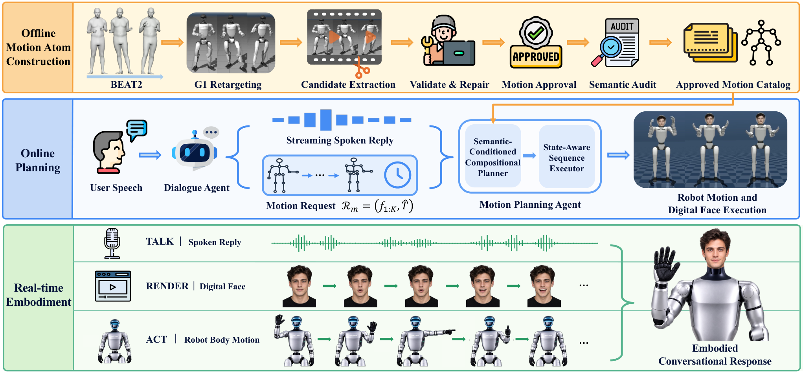
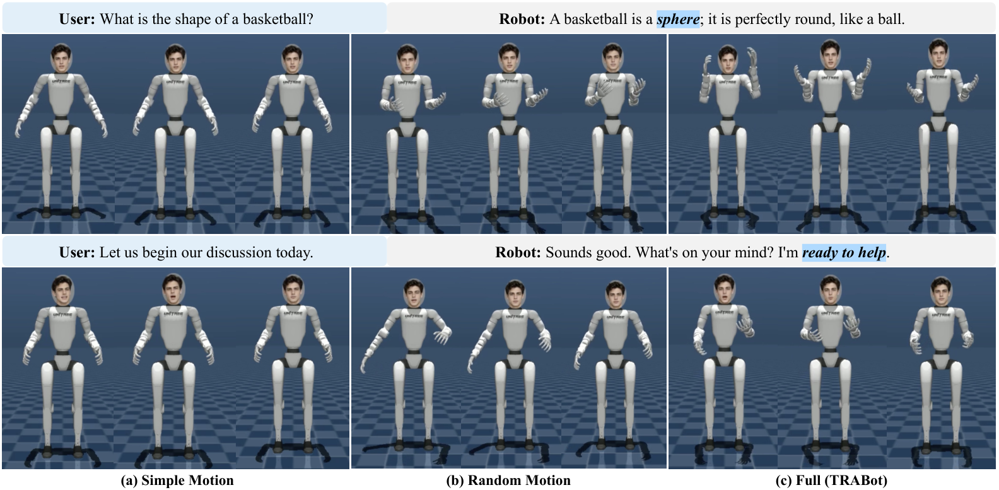

<div align="center">

# Talk, Render, Act: Integrating Social Gesture and Digital Face with Synchronized Speech for Conversational Humanoid Robot

[Jin Jiang](https://github.com/jiangjin1246), Kun Li, Jiancong Ma, Shengcai Liao<sup>&#8224;</sup>

College of Computing and Artificial Intelligence, United Arab Emirates University

<sup>&#8224;</sup>Corresponding author

[](https://arxiv.org/abs/2610.06153)
[](https://github.com/jiangjin1246/TRABot-Code)
[](https://www.unitree.com/g1)
[](https://github.com/Soul-AILab/SoulX-FlashHead)
[](LICENSE)

</div>

## 📣 Updates

- **2026.11** Code and the 113-atom motion library released.

## 🔎 Overview

<p align="center">
  
</p>

**TRABot** (Talk, Render, Act) lets a Unitree G1 humanoid hold a live spoken
conversation while showing an audio-driven digital face and performing
co-speech gestures that follow what it is saying. It is built from four agents:

- **Motion Atom Construction Agent** (offline): segments G1-retargeted BEAT2
  motion into **Robot-Ready Semantic Motion Atoms** with natural gesture
  boundaries, checks joint, velocity, acceleration, jerk and self-contact
  constraints, repairs near-misses, and labels each atom with one of 17
  communicative functions (Qwen3-VL proposal + two human audits).
- **Dialogue Agent**: Gemini 3.1 Flash Live streams the spoken reply together
  with an ordered list of communicative functions and an estimated duration T̂.
- **Motion Planning Agent**: a **Semantic-Conditioned Compositional Planner**
  selects approved atoms that fit the reply, and a **State-Aware Executor**
  commits one atom at a time and replans from the measured robot state.
- **Facial Animation Agent**: SoulX-FlashHead renders the talking face from the
  reply audio; face, speech and body share the reply audio clock at 25 FPS.

## 📁 Repository Structure

The folders follow the workflow of the paper, from building the atom library to
running on the real robot.

```
TRABot-Code
├── catalog/              # motion-atom library shared by every step
├── face/                 # web app: Gemini Live + WebRTC + SoulX-FlashHead
├── atom_construction/    # ① offline atom extraction, constraint checks, repair
├── atom_review_g1/       # ② review and play atoms one by one on the real G1
├── sim/                  # ③ full TRABot system in MuJoCo
├── real_g1/              # ④ full TRABot system on the real G1 (with face)
├── real_g1_woface/       # ⑤ real G1 without the face (CPU only)
├── assets/               # README figures
├── environment/          # pinned pip packages of the two conda envs
└── scripts/              # fetch_external.sh (Unitree MuJoCo model + SDK)
```

| Step | Folder | Needs a G1 | Needs a GPU |
|---|---|---|---|
| ① | `atom_construction/` | no | no |
| ② | `atom_review_g1/` | for playback | no |
| ③ | `sim/` | no | yes |
| ④ | `real_g1/` | yes | yes |
| ⑤ | `real_g1_woface/` | yes | no |

### 🤖 Motion-atom library (`catalog/`)

| File | Content |
|---|---|
| `catalog/semantic_atom_catalog_v1.6725cb58….json` | **113 atoms** labelled with **17 communicative functions** (used in simulation) |
| `catalog/g1_reviews.json` | real-G1 review of the same 113 atoms: **103 approved**, 10 rejected (used on the robot) |
| `catalog/dialogue_function_17_v1.json` | the 17-function ontology used by the planner and the Gemini prompt |
| `catalog/safe_neutral.json` | canonical neutral arm pose |
| `catalog/legacy_gestures/` | 3 hand-made gestures of the *Simple Motion* baseline |
| `catalog/previews/semantic_realtime_review_v1/` | MuJoCo preview clips used by the robot runtimes |

The real-robot library is **the same catalog plus `catalog/g1_reviews.json`**: the robot
runtimes only play approved atoms. The runtimes verify the catalog's SHA-256
(it is part of the file name), so do not edit or re-save the catalog.

## ⚒️ Installation

```bash
git clone https://github.com/jiangjin1246/TRABot-Code.git
cd TRABot-Code

# face / dialogue / planner
conda create -n flashhead python=3.10 -y
conda run -n flashhead pip install -r environment/flashhead.txt

# MuJoCo simulator and atom extraction
conda create -n g1-mujoco python=3.10 -y
conda run -n g1-mujoco pip install -r environment/g1-mujoco.txt

# Unitree G1 MuJoCo model + unitree_sdk2, at the commits used in the paper
bash scripts/fetch_external.sh
```

Tested environment: Ubuntu 24.04, Python 3.10, PyTorch 2.7.1 + CUDA 12.8,
2× RTX 5080 16GB. `environment/*.txt` pin the package versions we used;
`flash-attn` must match your CUDA / PyTorch build (the wheel we used is noted at
the end of `environment/flashhead.txt`). `ffmpeg` is required for recording.

The scripts find the envs through `conda info --base`. If yours live elsewhere,
set `FLASHHEAD_PYTHON` / `G1_MUJOCO_PYTHON` in the `config.env` of the folder you
run (e.g. `sim/config.env`).

## 📦 Download Weights

TRABot uses the official face and audio-encoder weights without modification.
Download them into `face/models/`:

```bash
huggingface-cli download Soul-AILab/SoulX-FlashHead-1_3B --local-dir face/models/SoulX-FlashHead-1_3B
huggingface-cli download facebook/wav2vec2-base-960h --local-dir face/models/wav2vec2-base-960h
```

| Model | Source | Local path |
|---|---|---|
| SoulX-FlashHead-1.3B (Lite / Pro) | [Soul-AILab/SoulX-FlashHead-1_3B](https://huggingface.co/Soul-AILab/SoulX-FlashHead-1_3B) | `face/models/SoulX-FlashHead-1_3B/` |
| wav2vec2-base-960h | [facebook/wav2vec2-base-960h](https://huggingface.co/facebook/wav2vec2-base-960h) | `face/models/wav2vec2-base-960h/` |

**Reference face.** `face/examples/refs/trabot_face.png` is the face used in the
paper and the default. Add your own portraits (`.png` / `.jpg`) to the same
folder; the page lists all of them. You can also upload one in the page.

**Gemini API key.** Type it in the page, or set `GEMINI_API_KEY` in the
`config.env` of the folder you run (e.g. `sim/config.env`; never commit it).

## 🚀 Usage

### ① Build motion atoms — `atom_construction/`

**Input:** a folder of BEAT2 takes retargeted to the 29-DoF G1 (`.pkl`, one per
take). We retargeted [BEAT2](https://pantomatrix.github.io/EMAGE/) to the G1 with
[GMR](https://github.com/YanjieZe/GMR) (retargeted data not included).

```bash
cd atom_construction
conda activate g1-mujoco
python -m unittest discover -s tests -t .        # unit tests, no data needed

# 1) freeze a speaker/session-stratified source selection
python -m atom_pipeline sources --source "$BEAT2_G1_PKL_DIR" \
    --max-speakers 25 --sources-per-speaker 2 --seed 20260915 --out runs/sources.json

# 2) extract + check constraints (automatic time-scale repair is on)
python -m atom_pipeline extract --source "$BEAT2_G1_PKL_DIR" \
    --source-manifest runs/sources.json --out-dir runs/atoms_v1 \
    --neutral ../catalog/safe_neutral.json \
    --scene ../external/unitree_mujoco/unitree_robots/g1/scene_29dof.xml

# 3) validate structure and content hashes
python -m atom_pipeline validate runs/atoms_v1/candidates
```

Each run writes the candidate atoms and a report per atom to `--out-dir`; run
`--help` for all thresholds. Too-fast candidates are stretched in time (up to 3×).

**Labelling.** For each atom, Qwen3-VL proposes one of the 17 communicative
functions, and the proposal is then reviewed by humans.

### ② Review atoms on the real G1 — `atom_review_g1/`

A web app that lists every atom with its MuJoCo preview, plays it on the robot,
and records approve / reject. This produced the 103 / 10 split in
`catalog/g1_reviews.json`.

```bash
cd atom_review_g1
cp config.env.example config.env
bash scripts/build_native.sh          # native runner (unitree_sdk2, Boost >= 1.75)
python3 scripts/validate_catalog.py   # catalog checks, no robot needed
bash scripts/start_web.sh             # http://127.0.0.1:8776
bash scripts/stop_web.sh
```

The server only answers requests for `127.0.0.1:8776`; tunnel with the same port
(`ssh -L 8776:127.0.0.1:8776 <server>`). With `G1_ATOM_REAL_ENABLED=0` (default)
nothing is sent to the robot. To play on the robot set `G1_ATOM_REAL_ENABLED=1`
and `G1_ATOM_NETWORK_INTERFACE`. Your decisions are saved to `atom_review_g1/runtime/reviews.json`.

### ③ Simulation — `sim/`

The complete TRABot system with a MuJoCo G1. The face is rendered onto the
robot's head and streamed to the browser as one WebRTC video.

```bash
cd sim
cp config.env.example config.env      # GPUs, SIM_MUJOCO_GL (egl = headless), ports
bash scripts/start_all.sh             # starts MuJoCo + web app
# open http://localhost:1121
bash scripts/stop_all.sh
```

In the page: **Connect WebRTC** → enter the Gemini key → **Start Gemini
Conversation**, then talk. Browsers only allow the microphone over HTTPS or on
`localhost`; if the server is remote, use an SSH tunnel
(`ssh -L 1121:127.0.0.1:1121 <server>`).

- The first conversation after installation compiles FlashHead's GPU kernels
  (1–2 min, *Generation State* = `preparing`; the robot already moves). Later
  replies stream the face in real time.
- **Record Experiment** saves audio, video and a per-reply trace to
  `sim/runtime/experiment_recordings/`.

### ④ Real G1 with face — `real_g1/`

Same dialogue, planner and executor as ③, driving the real G1 through a native
runner (`real_g1/g1_bridge/`, unitree_sdk2). Only the 103 atoms approved in
`catalog/g1_reviews.json` are played; the browser shows the face.

```bash
cd real_g1
cp config.env.example config.env
bash scripts/build_g1_bridge.sh
# robot ready: set G1_REALTIME_ENABLED=1 and G1_REALTIME_NETWORK_INTERFACE in config.env
bash scripts/start_realtime.sh        # http://127.0.0.1:1131
bash scripts/stop_realtime.sh
```

> ⚠️ **Safety.** The atoms were reviewed on our G1 only. Run the robot in a clear
> area with an operator at the emergency stop. `real_g1/scripts/start_realtime.sh` refuses to
> start unless `G1_REALTIME_ENABLED=1` and the network interface is up. You use
> this code on real hardware at your own risk.

### ⑤ Real G1 without face — `real_g1_woface/`

④ without the digital face, for convenience: it runs on CPU, e.g. on the
robot's own computer. Install `real_g1_woface/requirements-woface.txt` and use it like ④.

## 📊 Results

<p align="center">
  
</p>

**System performance** (12 utterances):

| Face offset (ms) ↓ | Body offset (ms) ↓ | Speech–body overlap (%) ↑ | Completed without failure (%) ↑ |
|---|---|---|---|
| 37.5 | −666.6 | 84.72 | 100 |

**User study** (20 participants, mean within-turn rank, 1 = worst, 5 = best):

| Condition | Natural ↑ | Express ↑ | Coherence ↑ | Gesture–speech ↑ | Preference (%) ↑ |
|---|---|---|---|---|---|
| Speech | 1.10 | 1.10 | 1.10 | N/A | 0.83 |
| Speech + Face | 2.10 | 2.10 | 2.08 | N/A | 0.42 |
| Simple Motion | 3.15 | 3.13 | 3.16 | 3.15 | 0.42 |
| Random Motion | 3.87 | 3.91 | 3.87 | 3.86 | 13.75 |
| **TRABot (Full)** | **4.79** | **4.76** | **4.79** | **4.77** | **84.58** |

## 🙏 Acknowledgements

The digital face is built on [SoulX-FlashHead](https://github.com/Soul-AILab/SoulX-FlashHead).
Gesture atoms were extracted
from [BEAT2](https://pantomatrix.github.io/EMAGE/), retargeted with [GMR](https://github.com/YanjieZe/GMR). The G1 model and SDK are from
[Unitree Robotics](https://github.com/unitreerobotics). We thank the authors for
sharing their work.

## 📖 Citation

```bibtex
@article{jiang2026trabot,
  title   = {Talk, Render, Act: Integrating Social Gesture and Digital Face with Synchronized Speech for Conversational Humanoid Robot},
  author  = {Jiang, Jin and Li, Kun and Ma, Jiancong and Liao, Shengcai},
  journal = {arXiv preprint arXiv:2610.06153},
  year    = {2026}
}
```

## 📜 License

This project is released under the [Apache 2.0 License](LICENSE).
